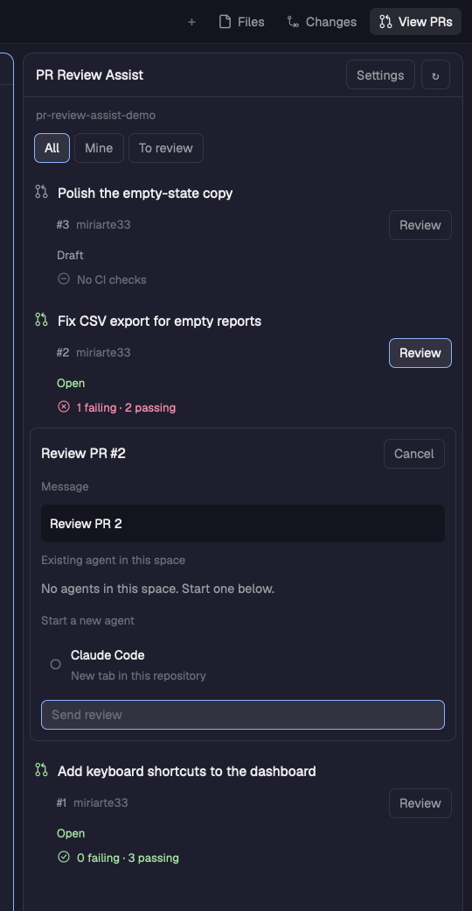

# PR Review Assist

A native Herdr desktop mod. **View PRs**, immediately to the right of **Changes**, opens pull requests for the focused terminal's repository.

- Each PR shows its lifecycle status and review decision, plus CI passing/failing counts. A green check means passing, a red cross means failing, and an amber clock means pending. Skipped and unknown results stay separate; PRs without checks show “No CI checks.”
- Click a PR row to open it on GitHub.
- Click **Review** to choose an existing idle agent in this space or start an installed agent in a new tab in this repository.
- The chooser previews the exact message. Click **Send review** or **Start review** to dispatch it.
- Open **Settings** in the same panel to edit and save the message template. The default is `Review PR {pr_number}`. Multiline messages and repeated placeholders work.
- **All**, **Mine**, and **To review** filter open PRs. Lists load 20 at a time and refresh every minute while visible.

Requires Herdr desktop's native mod API and authenticated `gh` on the repository's machine. Existing agents that are working or blocked are shown as unavailable. The core rechecks idle status when sending. Starting a new agent uses Herdr's normal startup and initial-task behavior; errors are reported by Herdr.



## Install

Ask your agent:

> Read ~/.config/herdr-app/AGENTS.md, then add this mod: https://github.com/miriarte33/herdr-pr-review-assist

Or clone this repository, inspect its files, and install it while Herdr is running:

```sh
git clone https://github.com/miriarte33/herdr-pr-review-assist.git
cd herdr-pr-review-assist
python3 scripts/install.py
```

No keybinding changes are needed. The [recipe](RECIPE.md) describes how to rebuild the mod from an empty folder or integrate it into another layout. The mod runs Git and GitHub CLI on the repository's machine, contacts GitHub through your authenticated `gh`, and sends agent input only when you click the final review action.

The installer adds the panel to the active personal layout. It clones the tab bar to `pr-review-assist-tabs`, preserves existing buttons and per-space panel memory, and inserts View PRs after Changes. Shipped layouts are cloned first. Installation needs a layout with `tabs`, `panel`, and `panel-body` nodes, like Herdr's main layout. Backups are kept before replacing personal files. There is no `layouts/` folder in this mod package.

The installed panel lives at `~/.config/herdr-app/mods/pr-review-assist`. Shared settings are persisted under `pr-review-assist.settings`; the installer does not reset them. Re-run the installer after source changes.

## Validation

```sh
npm test
herdr-app check ~/.config/herdr-app/mods/pr-review-assist
herdr-app check ~/.config/herdr-app/mods/pr-review-assist-tabs
```

The tests execute the actual mod with mocked host APIs, covering repository races, row navigation, Review event propagation, saved templates, existing-agent guards, new-agent arguments, and send failures. They do not message live agents. The mod was also rendered in Herdr against a real GitHub PR, including settings and installed-agent choices.

Optional mod commands: `pr-review-assist.refresh`, `pr-review-assist.settings` (toggle), and `pr-review-assist.review-<number>` (toggle the chooser for a loaded PR, e.g. `review-2`). No command sends a review without the user's button click.

## Remove

Restore the layout backup named `main-reviewer.json.before-pr-review-assist-*` (or the corresponding layout name), then remove the two installed mod folders. Alternatively, point the tabs block back to its original mod and remove the `pr-review-assist` child from `panel-body`. Saved review settings may remain without affecting other mods.
