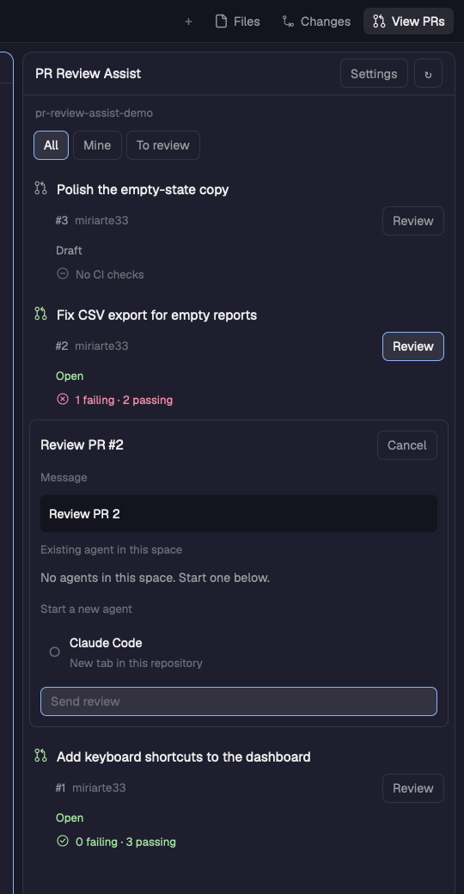

# PR Review Assist

Put **View PRs** immediately to the right of **Changes** in Herdr desktop. It opens a side panel of the focused repository's open GitHub pull requests, with PR status, review decision and CI counts. Clicking a row opens GitHub; **Review** expands an agent chooser and an editable review message. **Settings**, in that same panel, edits the review message.

## What you see

Use Herdr's current theme and UI font. The panel is 420px wide initially, with a 1px theme border and 10px corners. From top to bottom:

- A 42px header: **PR Review Assist**, **Settings**, and a refresh button.
- The repository folder name in dim 11px text (tooltip: full path), then **All**, **Mine**, and **To review** filter buttons.
- A scrolling body, with optional settings above the PR rows.
- An 11px footer reading `3 open · Row opens GitHub` (`3 open+` when more can load), or **Refreshing…** while loading.

Each PR row has 10px padding, 6px spacing, a 14px PR icon, a wrapping title, number, author and a 28px **Review** button. Below its metadata are the lifecycle status and optional review decision, then a CI icon and counts. Use 13px body text, 12px controls and 11px supporting text. Hover highlights the row. Its tooltip shows source and target branches.

Open PRs are green; drafts are muted. Lifecycle rendering also recognizes Closed (red) and Merged (accent), although the list only fetches open PRs. Review decisions read **Approved**, **Changes requested**, or **Review required**; changes requested is red. CI reads, for example, **2 failing · 5 passing · 1 pending**, with skipped and unknown counts when applicable. A red circle-X means failures; an amber clock means pending without failures; a green circle-check means passing without pending or unknown results. Empty, unknown or entirely skipped results get a muted circle-minus. Empty results say **No CI checks**.

The inline chooser has the PR number, **Cancel**, the substituted message in a multiline field (labelled **Message · edited for this PR** with a **Use template** button once edited), existing agents in this space, installed new-agent choices, error feedback and a final **Send review** or **Start review** button. Choices use radio indicators. Settings contains **Review message**, a multiline field, placeholder instructions, inline validation, **Save**, **Use default** and saved feedback. The default message is `Review PR {pr_number}`.

## How it behaves

The focused terminal determines repository and machine. Focusing a mod pane preserves the previous terminal context within that space, with its sibling terminal as a fallback. Changing folder or space clears the old list and chooser; late responses from the old context never paint the new one.

List open PRs in most-recently-updated order, 20 at a time. **Mine** filters by the authenticated author; **To review** filters by review requests for that user. **Load more** asks for 20 additional results. Refresh every 60 seconds while visible and on the refresh button. Loading shows **Loading pull requests…**. Empty lists say **No open pull requests**, **No open pull requests of yours** or **No reviews requested**, with **Refresh to check GitHub again.** below. Errors show **Couldn't load pull requests** and the message. Missing tools, authentication and repository problems show errors; refreshing can retry.

A row opens its exact GitHub URL. **Review** stops propagation and toggles the chooser without opening GitHub. Choosing a destination only selects it. The final dispatch button is disabled until a choice is made. Existing **idle** and **done** agents are selectable; **working** and **blocked** agents remain visible but muted and marked unavailable. Show each agent's program, tab name, literal status and terminal address. An exited agent cannot receive a message. Show installed new-agent programs in Herdr's preferred order; a new review opens a tab in this repository and space. Do not interrupt busy agents. Recheck readiness at send time. Prevent duplicate existing-agent sends; a failed send retains the chooser and error, and a successful send closes it with confirmation. Herdr handles new-agent launch errors. **Cancel** or Escape closes the chooser when no send is in progress.

The chooser's message field starts as the saved template with the PR number filled in. Editing it changes only that PR's message; the template is untouched. Edits are kept per PR while the repository context stays the same, so closing and reopening the chooser keeps them. A successful send, **Use template**, or a repository or space change discards them. Saving Settings refreshes the field only for PRs without edits. A blank message cannot be sent.

Settings stays in the same scrolling panel. Save a nonblank template containing `{pr_number}`; replace every occurrence when previewing or sending, preserving line breaks and literal characters. **Use default** saves the default immediately. Settings survive reloads and are shared between panel copies. No review is sent by opening the panel, opening Review, selecting a destination or editing Settings. No keyboard binding is required. There is no decorative motion.

## Built from

The package has `mods/pr-review-assist/`, this recipe, `preview.png`, an optional installer, and tests. It has no `layouts/` folder or required `keys.json`. The mod consists of `main.js`, `model.js`, `mod.json` (`{"place":"none","title":"PR Review Assist"}`), `pr.svg` and four circle icons (`check-pass`, `check-fail`, `check-pending`, `check-none`). Art is simple current-color SVG with 1.7px strokes, sized by the UI.

Integrate into the host's existing tree: in its work column, the `tabs` block sits above `work-body`; `work-body` contains the active-terminal block and a `panel` column; the column contains a `panel-body` stack. Add a block with id `pr-review-assist` and content `{mod:"pr-review-assist"}` to that stack. The panel takes no props. Its visibility check uses these node IDs. Clone the host tab-bar mod before editing, then point only the host's tabs block at the clone. The supplied installer calls its clone `pr-review-assist-tabs`. Add a `panelButton` after Changes, selecting this stack child and showing/hiding `panel`. Include the new panel in the tab bar's allowed per-space restoration list. Keep existing panels and tab behavior. No replacement layout is distributed. Shipped layouts must be cloned before structural edits.

Use `gpui-kit` View/div/svg and `gpui-base` flex/TextareaState/Textarea; Herdr's live `spaces`, `panes`, `focused`, `agents`, `theme`, `layout`, `shared`, `setShared`, `knownAgents`, `exec`, `hc`, `run`, `notify` and `nextCommand`. Persist `{template}` under shared key `pr-review-assist.settings`.

Resolve the root with `git --no-optional-locks -c core.fsmonitor=false rev-parse --show-toplevel`. Fetch via `gh pr list --state open --limit N --search SEARCH --json number,title,author,isDraft,url,headRefName,baseRefName,updatedAt,state,reviewDecision,statusCheckRollup`. SEARCH is `sort:updated-desc`, `author:@me sort:updated-desc`, or `review-requested:@me sort:updated-desc`. Run both on the repository's machine via `exec`'s `cwd` and `on` options. These programs read repository data; `gh` contacts GitHub using the user's authentication.

Open links with `cx.open_url`. Send an existing review through `hc(["send", address, message, "--if", "idle", "--json"])`; the core's idle guard is atomic, and UI done corresponds to core idle. Start an agent with `run("tab.new", {space, folder:root, name, argv:program.run, task:message})`. Herdr owns startup and first-task delivery. Arguments are literal; do not interpolate the message into shell code. Optional mod commands are `pr-review-assist.refresh`, `pr-review-assist.settings` (toggle), and `pr-review-assist.review-N` (toggle the chooser for an already-loaded PR number).

## Watch out

This is native GPUI, not HTML or Node. The installed `herdr.d.ts` and `gpui-kit.d.ts` are authoritative; this build was checked on Herdr desktop 0.1.10. No top-level await, setTimeout, or retained old cx. Do not call `cx.notify` during render. Async work can start there, but redraw only from its completion. Use generation plus context matching to discard stale loads. The initial `herdr-app check` does not exercise deferred rows, settings, async states or real sizing; also try them in the app.

A saved panel width of 24px made a functioning panel appear absent; initialize it at 420px without changing the rest of the layout. A space switch may asynchronously restore its remembered panel, so let it settle before opening another panel programmatically. The installer assumes the named main-layout stack and native tab-bar shape above; other layouts need manual integration. Never overwrite unrelated mods or keybindings on name collisions. Generated `.d.ts`, `jsconfig.json` and Python caches are not distributable mod sources.

CI rollups mix CheckRun `status`/`conclusion` with legacy StatusContext `state`. Unfinished runs and PENDING/EXPECTED contexts count as pending. SUCCESS counts as passing. FAILURE, ERROR, TIMED_OUT, ACTION_REQUIRED, STARTUP_FAILURE, CANCELLED and STALE count as failing. SKIPPED and NEUTRAL are separate from passing. Unexpected completed conclusions count as unknown. Failure takes priority over pending, then unknown, then passing. Counts describe GitHub's reported rollup, not a separate branch-protection decision. This panel does not merge PRs, post GitHub reviews or rerun checks. Authenticated `gh` must exist on remote repository machines too.

## Done when

- View PRs sits immediately right of Changes and toggles the correct panel; other panels and per-space memory still work.
- Open PRs load for the focused repository; filters and pagination work, and row clicks open the exact URLs.
- Status and CI counts distinguish mixed failure/pending/success, skipped, unknown and empty results without falsely claiming success.
- Review expands inline without navigating, shows the message for editing (per PR, not saved to the template), and shows live existing-agent statuses plus installed new-agent choices.
- Dispatch targets the chosen existing idle agent, or starts the chosen program in the captured space and repository with the configured first message.
- Settings saves multiline templates, replaces every PR placeholder, persists across reloads and rejects missing placeholders or blank text.
- Repository-switch races, busy/exited agents and failed sends cannot misdirect input.
- The panel and tab-bar clone pass `herdr-app check`; the actual panel, settings and chooser render correctly; the behavior tests pass without messaging live agents.
